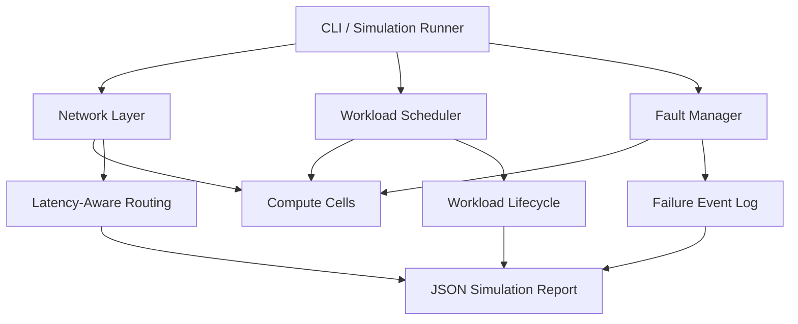

# NEXUS-L Simulator Architecture

NEXUS-L is a modular Python simulation of distributed computing across interconnected compute cells. It models resource allocation, workload scheduling, network routing, and fault handling.

## System Architecture



## Core Components

### Compute Cells

Represent individual compute resources. Each cell tracks CPU and memory capacity, resource usage, and operational status: online, offline, or degraded. Resource allocation validates capacity before committing changes.

### Network Layer

Uses a graph-based topology to represent connections between compute cells. It supports route calculation and latency-aware path selection, allowing the simulation to compare routes before and after a failure.

### Workload Scheduler

Evaluates workload resource requirements against available compute capacity. It tracks workload lifecycle states, including pending, running, completed, rejected, and failed.

### Fault Manager

Detects offline compute cells and records the impact on running workloads. Failure events include timestamps and affected workload information.

### CLI and Evidence Reporting

The command-line interface runs the demonstration, coordinates the components, and can export a JSON report containing simulation results, route information, workload states, and failure events.

## Demonstration Flow

1. Build a network of interconnected compute cells.
2. Calculate the initial route and its latency.
3. Schedule a workload against available compute resources.
4. Simulate a compute-cell failure.
5. Record affected workloads and calculate an alternative route.
6. Export the results as JSON for inspection.

## Design Principles

- **Modularity:** Network, scheduling, resource, and fault logic are separated.
- **Resource safety:** Allocation requests must respect CPU and memory limits.
- **Observable behavior:** Failures and simulation outcomes are recorded.
- **Testability:** Core behavior is validated with automated tests.
- **Honest scope:** NEXUS-L is an experimental software simulator, not a physical computer, production orchestration platform, or cloud service.

## Verification

Run the project checks from the repository root:

```powershell
.\.venv\Scripts\ruff.exe check .
.\.venv\Scripts\pytest.exe -q
```
